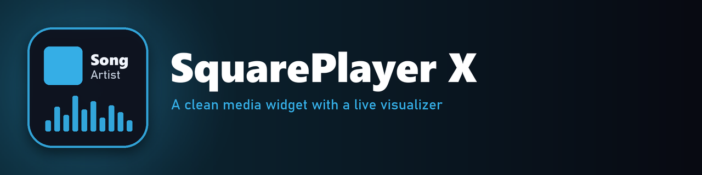

  
  
  

**SquarePlayer X** shows what's playing: cover art, song and artist, with an audio visualizer, in a clean frosted panel with no buttons.

## What it does

- **Shows the current song** with its cover art, title and artist.
- **Fits the song.** The panel grows and shrinks to fit the title.
- **Live visualizer** that adapts to how loud the music is.
- **Works with desktop and browser players** through WebNowPlaying 3.x. It follows whichever player is active, or you can pin one.
- **Frosted glass background** in dark or light, with round or square corners.

## You also need

- **[WebNowPlaying 3.x](https://github.com/keifufu/WebNowPlaying-Rainmeter)** by keifufu, plus its browser extension if you want browser players.
- **[FrostedGlass](https://github.com/TheAzack9/FrostedGlass)** by TheAzack9, for the blurred background.

## Fonts

The fonts I use are paid fonts, so they aren't included. Put any fonts you like in `@Resources/Fonts`, then set `TitleFont` and `ArtistFont` at the top of `SquarePlayer.ini` to their names. Rainmeter loads fonts from that folder by itself.

## Settings

Under `[Variables]` in `SquarePlayer.ini`: `Scale`, `Color`, `SubColor`, `Highlight`, `FrostLevel`, `Theme` (`Dark` or `Light`), `CornerType` and `PlayerId` (`Active`, or a player number to pin one).

## Install

Download the `.rmskin` file from **[Releases](https://github.com/SteelArchadian/SquarePlayer-X/releases/latest)** and double-click it. Rainmeter installs and loads it.

## Credits and license

SquarePlayer X is a rework of **[SquarePlayer](https://github.com/Meti0X7CB/SquarePlayer)** by **Meti0X7CB**, released under the [GNU GPL v3.0](LICENSE) like the original. Thank you, Meti0X7CB!

What's different from the original: WebNowPlaying 3.x support (desktop and browser players), an adaptive visualizer, and fonts loaded from the skin's own folder.

Made with help from Claude (an AI).

## Bugs and ideas

Post them on [GitHub Issues](https://github.com/SteelArchadian/SquarePlayer-X/issues).
